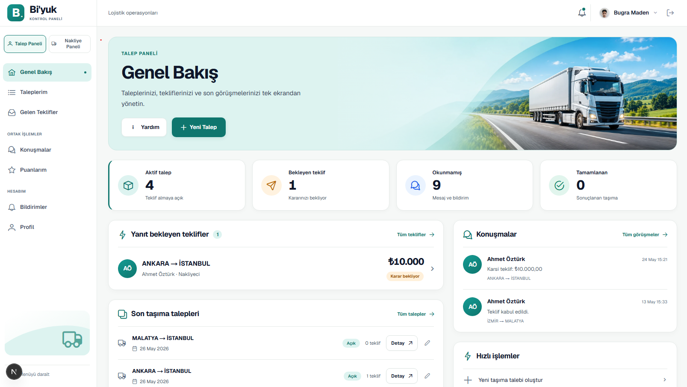
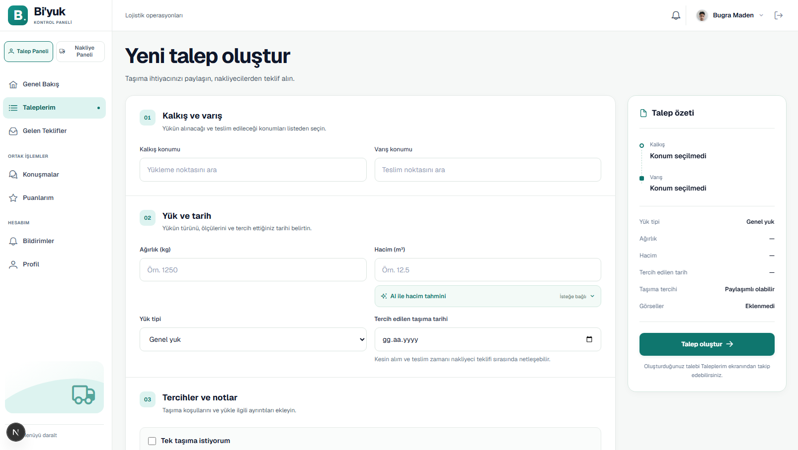
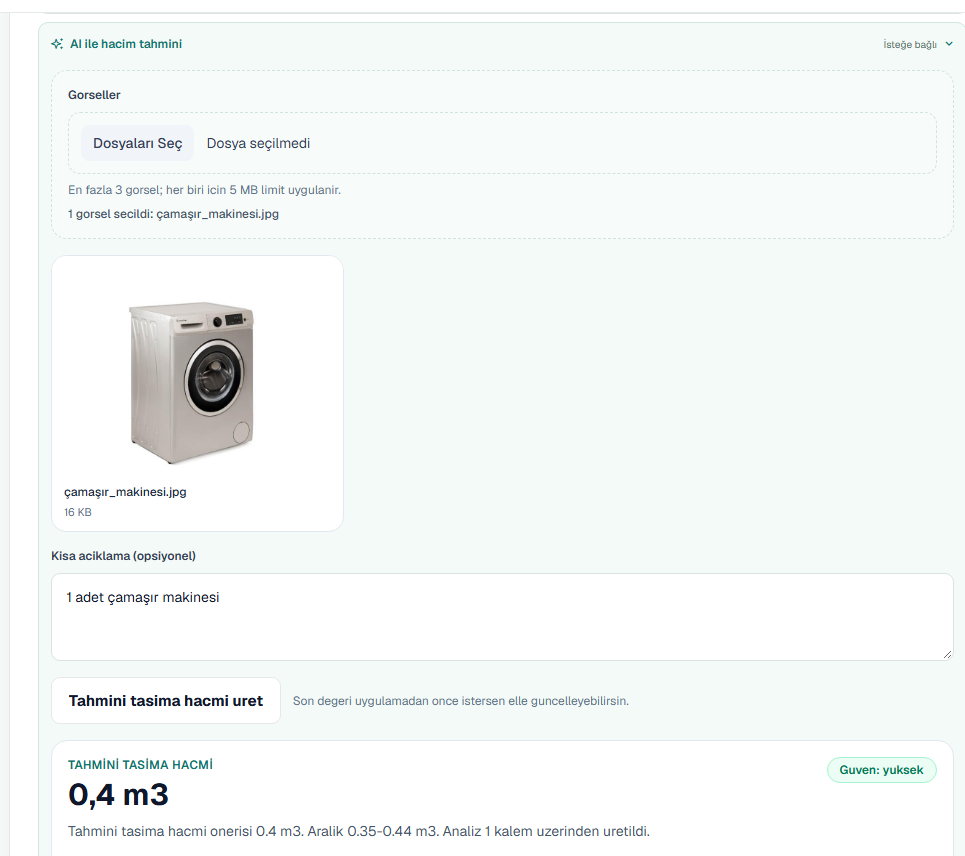
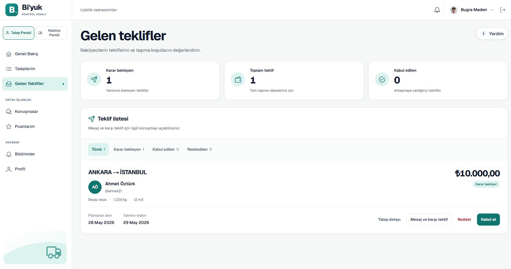
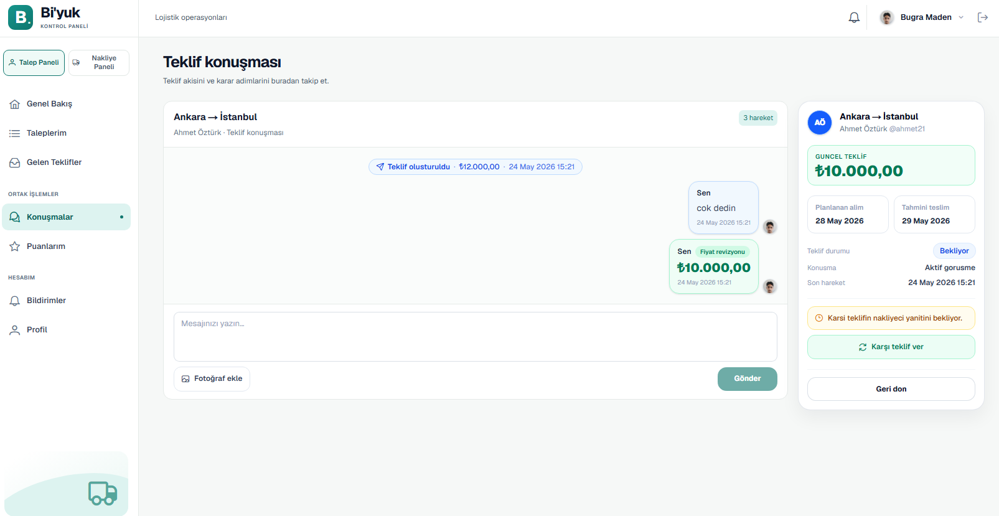
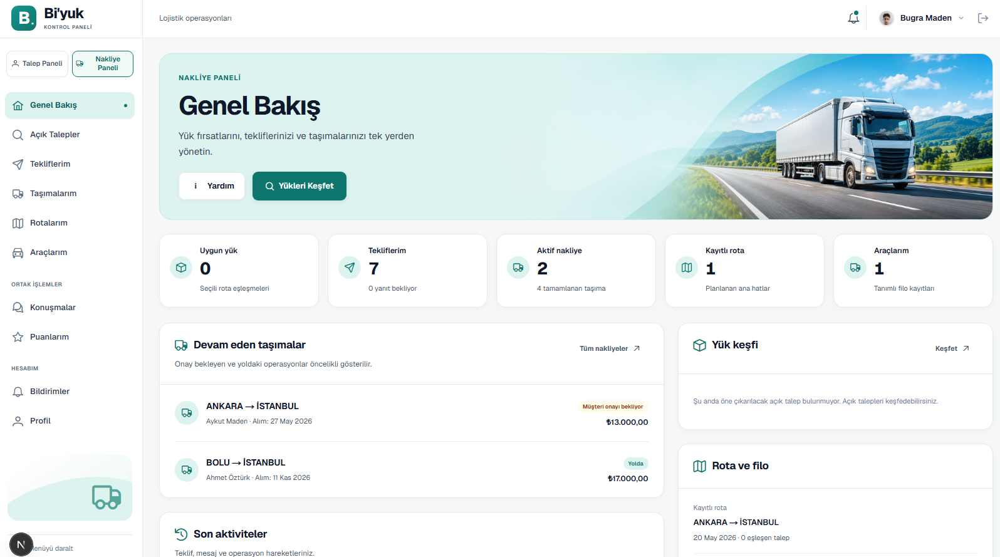
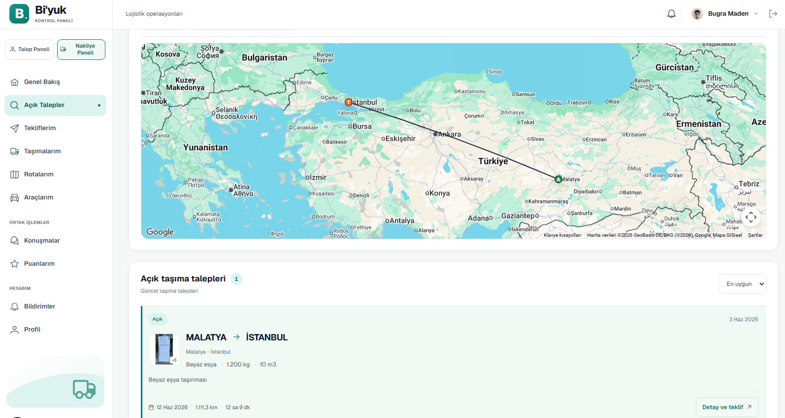
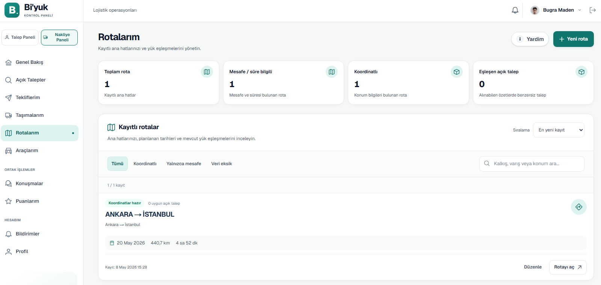
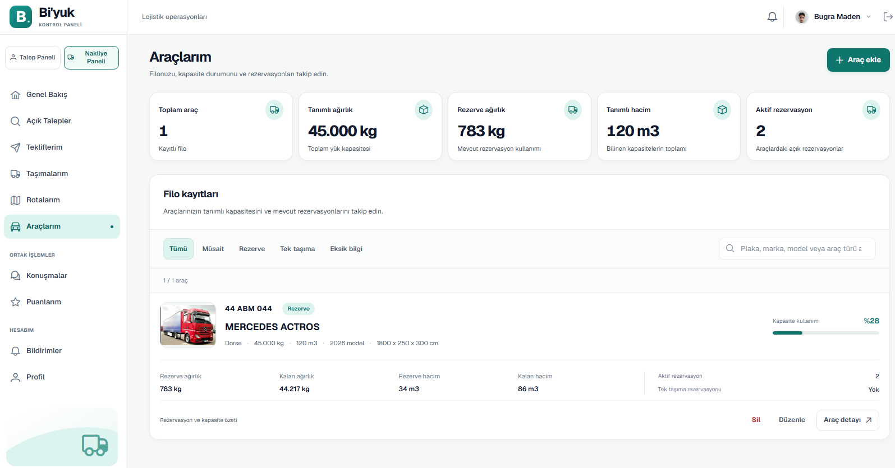
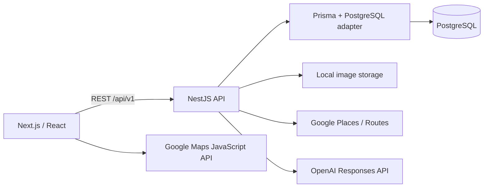

# Bi'yuk — AI-Assisted Logistics Management Platform

Bi'yuk is a full-stack logistics platform that connects transport request owners with carriers, keeping cargo details, offers, negotiations, vehicle capacity, and shipment progress in one workflow. It combines **Next.js/React**, **NestJS**, **PostgreSQL/Prisma**, **Google Maps**, and the **OpenAI Responses API**.

[](docs/BiYuk-Screenshots/01-talep-genel-bakis.png)

The project was developed as a **Workplace Training Project** within the **Computer Engineering program at Gazi University**. The application interface is in Turkish.

- **Two role-based workspaces** — Request Panel and Carrier Panel.
- **AI-assisted cargo volume estimation** — optional photo-based guidance.
- **Offers and negotiations** — offer-specific messaging and counter-offers.
- **Google Maps and route management** — load discovery and saved routes.
- **Vehicle and shipment management** — capacity, transport jobs, and delivery steps.

## The logistics problem

Arranging a shipment involves more than finding a vehicle. Cargo details, pickup and delivery locations, available capacity, prices, and delivery dates need to stay connected as a request moves from negotiation to transport.

Bi'yuk brings these steps into one application. Request owners describe what needs to be moved, carriers evaluate suitable loads and make offers, and both sides follow the agreed job through delivery confirmation.

## Two connected workspaces

| Workspace | Main workflow |
| --- | --- |
| **Request Panel — Talep Paneli** | Create requests, manage cargo details and photos, compare incoming offers, negotiate terms, and confirm delivery. |
| **Carrier Panel — Nakliye Paneli** | Discover open requests, review locations and route suitability, submit offers, manage vehicles and saved routes, and carry out accepted jobs. |

In this README, **Transport Request** corresponds to **Taşıma Talebi**, and **Shipments / Transport Jobs** to **Taşımalarım**.

Registration offers two usage options:

| Registration option in the Turkish UI | English meaning | Workspace access |
| --- | --- | --- |
| **Talep Oluşturacağım** | I will create transport requests | Request Panel |
| **Her İkisini Yapacağım** | I will do both | Request Panel and Carrier Panel, with first-vehicle registration required |

Every new account receives request-management access. Choosing **Her İkisini Yapacağım** requires first-vehicle details during registration; both panels become available when registration succeeds. An existing Request Panel user can also enable the Carrier Panel later by completing vehicle onboarding from Profile. Accounts with both business roles can switch between panels. Conversations, ratings, notifications, and profile screens are shared across the workspaces.

The main transport flow is:

```text
Create request → Discover load → Submit / negotiate offer → Accept offer
              → Capacity reservation → Start transport → Report delivery
              → Request owner confirms delivery → Completed job and rating
```

## Features

- **Accounts and workspaces:** registration with the two usage options above, JWT access/refresh tokens, bcrypt password hashing, Request Panel and Carrier Panel access, and an administrator-only user list. Request Panel users can complete vehicle onboarding to use both business roles.
- **Transport requests:** pickup and delivery locations, cargo type, weight, volume, planned date, request images, and request management.
- **Vehicles and routes:** vehicle dimensions, weight/volume limits, vehicle images, and carrier-defined routes.
- **Request discovery:** list and map views, city and cargo filters, and route-aware suitability information such as additional distance, travel time, and available capacity.
- **Offers and negotiation:** offers with planned pickup/delivery dates, acceptance and rejection, counter-offers, and offer-specific conversations with text, image messages, and read status.
- **Shipment lifecycle:** accepted offers create transport jobs and capacity reservations. Carriers start jobs and report delivery; request owners confirm delivery before the workflow is completed.
- **Activity and profiles:** in-app notifications with read/unread state, ratings for completed jobs, profile images, and account deletion.

## AI-assisted volume estimation

The optional volume assistant helps request owners enter a cargo volume estimate while creating a new transport request.

1. The request owner uploads **1–3 JPG, PNG, or WebP images**, up to **5 MB per image** and **12 MB combined** under the default API limits, with an optional description.
2. The API validates and normalizes the images with Sharp, then sends them to the configured OpenAI model through the Responses API.
3. The model returns structured item analysis, including item profiles, inferred size classes, handling characteristics, confidence, and warnings. A server-side shape/profile-based calculator converts this analysis into a recommended volume and a minimum/maximum range in cubic metres.
4. The request owner reviews the result and can apply the suggested value to the request form.

The estimate is based on visual interpretation and predefined volume heuristics. It should be checked against actual cargo dimensions and vehicle limits. The default model setting is `gpt-4.1`; model selection, request limits, timeouts, and image-processing limits are configured through environment variables.

The assistant runs inside the NestJS API and requires a valid OpenAI API key, model access, and available API credits. It does not require a separate AI server. Manual volume entry remains available when the provider is unavailable or the assistant is not configured.

Implementation: [OpenAI provider](apps/api/src/modules/volume-estimation/openai-volume-estimation.service.ts) · [Volume calculator](apps/api/src/modules/volume-estimation/shape-based-volume-calculator.service.ts).

## Screenshots

Nine selected captures are displayed across the opening overview and the workflow gallery below, with three additional screens linked at the end of the gallery. All twelve were captured from a local demo/test environment. Click a screenshot to inspect it at its original resolution. The interface is in Turkish; the records and counts shown are screen contents, not adoption or performance statistics.

### 1. Request Management

The opening overview brings pending offers, recent requests, and conversations together. The creation form below groups locations, cargo details, preferences, photos, and an optional AI helper.

[](docs/BiYuk-Screenshots/02-yeni-talep.png)

### 2. AI-Assisted Volume Estimation

This capture shows an image input and an example estimate with a volume range and confidence indicator. The displayed result illustrates the review step; it is not a measurement-accuracy benchmark or a live service-status check.

<a href="docs/BiYuk-Screenshots/03-ai-hacim-tahmini.png"></a>

### 3. Offers and Communication

Incoming offers show the route, carrier, price, and planned dates. Each offer has a conversation for messages and counter-offers, with its current terms available alongside the message flow.

| Incoming offers | Offer conversation and counter-offer |
| --- | --- |
| [](docs/BiYuk-Screenshots/05-gelen-teklifler.png) | [](docs/BiYuk-Screenshots/06-teklif-konusmasi.png) |

### 4. Carrier Operations and Route Management

Carriers can review ongoing jobs, discover loads on a map, manage saved routes, and inspect vehicle capacity and reservations. The map is displayed above the results and can be hidden while browsing the list.

| Carrier overview | Open requests — map visible |
| --- | --- |
| [](docs/BiYuk-Screenshots/07-nakliye-genel-bakis.png) | [](docs/BiYuk-Screenshots/08-acik-talepler-harita.png) |

| Saved routes | Vehicles and capacity |
| --- | --- |
| [](docs/BiYuk-Screenshots/10-rotalarim.png) | [](docs/BiYuk-Screenshots/11-araclarim.png) |

<details>
<summary>Additional screens — request list, map-hidden discovery, and carrier offers</summary>

| Category | Screen |
| --- | --- |
| Request Management | [My requests: status filters, cargo details, and management actions](docs/BiYuk-Screenshots/04-taleplerim.png) |
| Carrier Operations and Route Management | [Open requests: filters and results with the map hidden](docs/BiYuk-Screenshots/08-acik-talepler.png) |
| Offers and Communication | [My offers: carrier-side offer statuses and conversation links](docs/BiYuk-Screenshots/09-tekliflerim.png) |

</details>

## Technology stack

| Area | Technologies |
| --- | --- |
| Frontend | Next.js 16.4.6, React 19.2.4, TypeScript |
| UI | Tailwind CSS 4, PrimeReact, PrimeIcons, GSAP |
| Backend | NestJS 11, TypeScript, class-validator, class-transformer |
| Authentication | Passport/JWT, bcryptjs |
| Database | PostgreSQL, Prisma ORM 7.6, PostgreSQL driver adapter |
| Maps and locations | Google Maps JavaScript API, Places API (New), Routes API |
| AI and media | OpenAI Node.js SDK / Responses API, Sharp, local filesystem storage |
| Quality checks | ESLint; backend tests with Jest, ts-jest, and Supertest |

## Architecture

The repository is an **npm workspaces monorepo** with a separate frontend and a NestJS modular monolith API.



- **Frontend:** pages, forms, dashboards, and an HTTP API client with access-token refresh handling.
- **Backend:** domain modules for authentication, users, roles, vehicles, routes, transport requests, offers, conversations, jobs, capacity, ratings, notifications, and volume estimation.
- **Application structure:** controllers handle HTTP input; services coordinate business rules and transactions; repositories encapsulate persistence queries where used. DTO validation, JWT/role guards, ownership checks, and a global exception filter support the API.
- **Persistence:** PostgreSQL stores application records and media references. Uploaded images are processed with Sharp and stored on disk.

```text
apps/
  web/
    src/app/  # App Router pages and layouts
    src/components/  # Forms, dashboards, maps, and shared UI
    src/features/  # Request, customer, and carrier workspace presentation
    src/lib/  # API client, authentication state, and utilities
  api/
    src/modules/  # Domain modules
    src/common/  # Guards, DTOs, errors, and shared helpers
    src/config/  # Environment-based configuration
    src/infrastructure/  # Prisma and media storage
    prisma/  # Database schema and migrations
    test/  # Backend tests
```

## Local setup

### Prerequisites

- Node.js **24.x** with npm, or **22.13+ within the 22.x line** to satisfy the current dependency engine requirements.
- A PostgreSQL database. The migration history enables `pgcrypto`, so the migration role must have permission to create that extension.
- Google Cloud configuration for location lookup, route calculations, and browser maps.
- An OpenAI API key with model access and available API credits to use the optional volume assistant.

### 1. Clone the repository

```bash
git clone https://github.com/aykutBugra/nakliye-app.git
cd nakliye-app
```

Run the following commands from the repository root unless another directory is shown.

### 2. Configure the environment

Copy the tracked examples if local environment files do not already exist:

```bash
test -f apps/api/.env || cp apps/api/.env.example apps/api/.env
test -f apps/web/.env.local || cp apps/web/.env.example apps/web/.env.local
```

PowerShell equivalent:

```powershell
if (!(Test-Path -LiteralPath "apps/api/.env")) {
    Copy-Item "apps/api/.env.example" "apps/api/.env"
}
if (!(Test-Path -LiteralPath "apps/web/.env.local")) {
    Copy-Item "apps/web/.env.example" "apps/web/.env.local"
}
```

Edit the copies before starting the application. The examples contain fictional credentials and public placeholders.

| File | Variables | Purpose |
| --- | --- | --- |
| `apps/api/.env` | `DATABASE_URL` | Connection to your PostgreSQL database |
| `apps/api/.env` | `JWT_ACCESS_SECRET`, `JWT_REFRESH_SECRET` | Two distinct, randomly generated signing secrets |
| `apps/api/.env` | `NEST_PORT`, `CORS_ORIGIN` | API port and allowed frontend origin; defaults are `4000` and `http://localhost:3000` |
| `apps/api/.env` | `GOOGLE_MAPS_API_KEY` | Server-side Places and Routes requests |
| `apps/api/.env` | `OPENAI_API_KEY`, `OPENAI_VOLUME_ESTIMATION_MODEL` | AI provider credentials and model selection |
| `apps/api/.env` | `MEDIA_PUBLIC_BASE_URL`, `MEDIA_LOCAL_ROOT` | Public API origin for image URLs and an optional upload-directory override |
| `apps/web/.env.local` | `NEXT_PUBLIC_API_BASE_URL` | API URL, including the `/api/v1` prefix |
| `apps/web/.env.local` | `NEXT_PUBLIC_GOOGLE_MAPS_BROWSER_API_KEY`, `NEXT_PUBLIC_GOOGLE_MAPS_MAP_ID` | Browser Maps key and map ID |

Keep the API URL and CORS origin consistent with the ports you use. Leave `MEDIA_LOCAL_ROOT` empty to use the default `apps/api/uploads` directory. `MEDIA_PUBLIC_BASE_URL` is the API origin, such as `http://localhost:4000`, without `/api/v1`.

For Google integration, enable Places API (New), Routes API, and Maps JavaScript API as needed. Use separate server and browser keys with appropriate API and application restrictions. See Google's [Places setup](https://developers.google.com/maps/documentation/places/web-service/get-api-key) and [Maps JavaScript setup](https://developers.google.com/maps/documentation/javascript/get-api-key) guides.

If you are not using the AI assistant, leave `OPENAI_API_KEY` empty and enter cargo volume manually. The API example also documents optional AI image, timeout, and rate-limit settings.

`NEXT_PUBLIC_*` values are exposed to the browser. Keep database credentials, JWT secrets, and server API keys in the API environment file. Local environment files and uploads are excluded by `.gitignore`.

### 3. Install dependencies and prepare the database

Create an empty PostgreSQL database and point `DATABASE_URL` to it, then run:

```bash
npm ci
npm run prisma:generate

cd apps/api
npx prisma migrate deploy
cd ../..
```

Run the migration command inside `apps/api` so its Prisma configuration loads that workspace's `.env` file. The committed migrations include role, status, and rating reference data. No demo users or administrator credentials are supplied.

See the [Prisma CLI reference](https://www.prisma.io/docs/orm/v7/reference/prisma-cli-reference#migrate-deploy) for migration command details.

### 4. Start the applications

In one terminal:

```bash
npm run dev:api
```

In another terminal:

```bash
npm run dev:web
```

| Service | Default address |
| --- | --- |
| Frontend | http://localhost:3000 |
| API base URL | http://localhost:4000/api/v1 |
| API process health check | http://localhost:4000/api/v1/health |

`npm run dev` starts only the frontend. Both processes are needed for the full application.

On the registration screen, choose **Talep Oluşturacağım** to use the Request Panel, or **Her İkisini Yapacağım** to create requests and provide transport services. The second option requires registering a first vehicle and enables both panels when registration succeeds. An existing Request Panel user can enable the Carrier Panel later through Profile by completing the same vehicle-onboarding step. Administrator access requires an account with an `ADMIN` role assignment.

## Development commands

Run these commands from the repository root:

| Command | Purpose |
| --- | --- |
| `npm run dev:web` | Start the Next.js development server |
| `npm run dev:api` | Start the NestJS API in watch mode |
| `npm run prisma:generate` | Generate the Prisma client |
| `npm run lint` | Lint both applications |
| `npm test` | Run the backend Jest suite |
| `npm run build` | Build the frontend, then the API |
| `npm run build:web` / `npm run build:api` | Build one application |
| `npm run start -w apps/web` | Serve the built frontend |
| `npm run start:prod -w apps/api` | Run the built API |

Backend tests cover authentication and onboarding, role restrictions, account deletion, offer acceptance, conversation rules, job completion, notifications, and volume-analysis parsing/calculation.

## Implementation notes

- Images are served by the API under `/uploads`; deployments need persistent storage for the upload directory.
- Messages and notifications are retrieved through HTTP endpoints.
- AI rate-limit counters are kept in process memory and reset when the API restarts.
- The current browser client stores authentication tokens in `localStorage`. Deployment security and session-management requirements should be reviewed for the intended environment.
