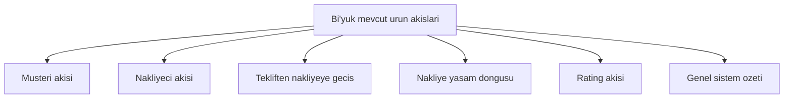
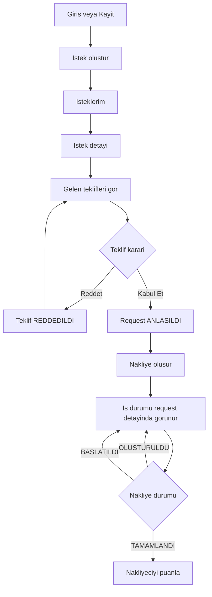
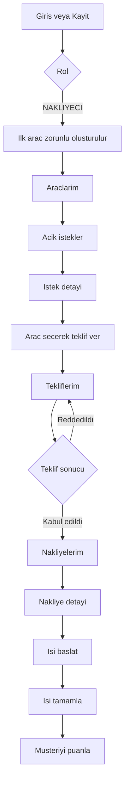
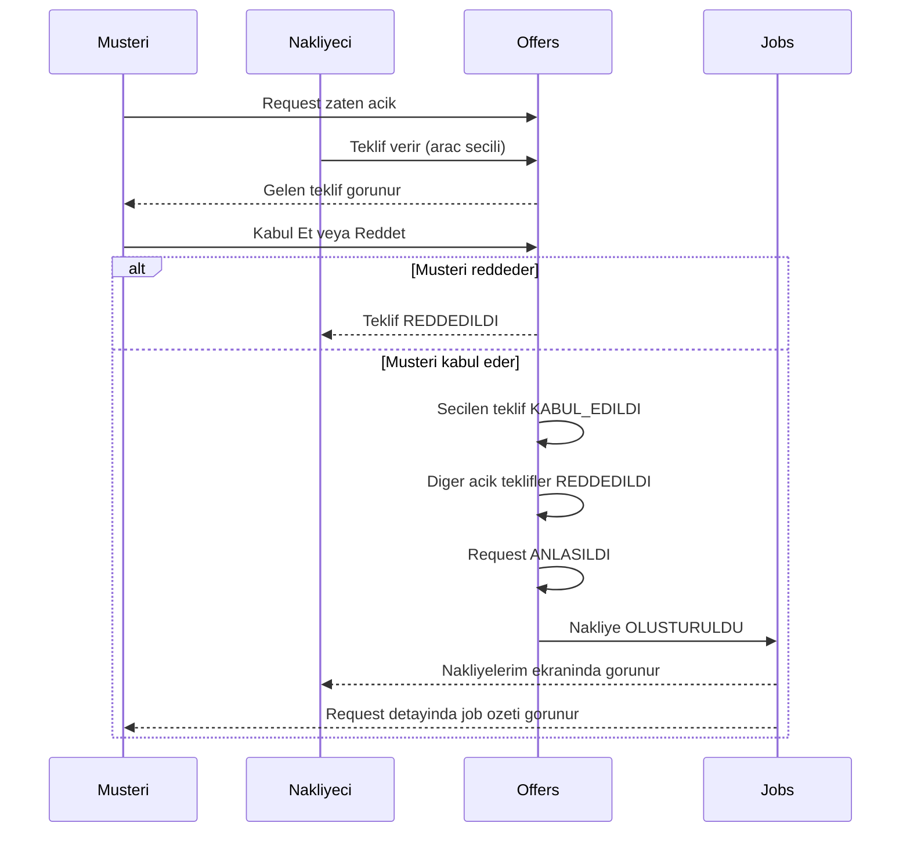
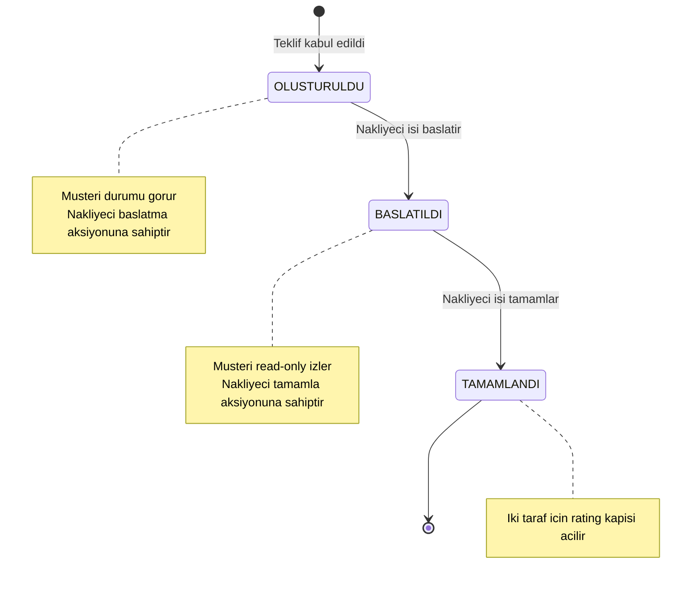
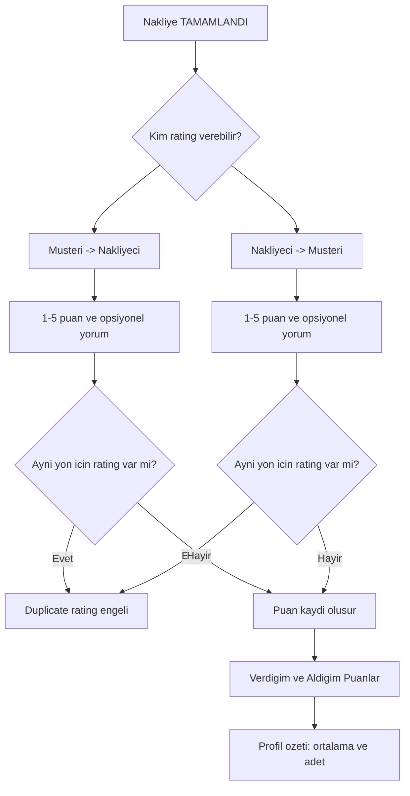
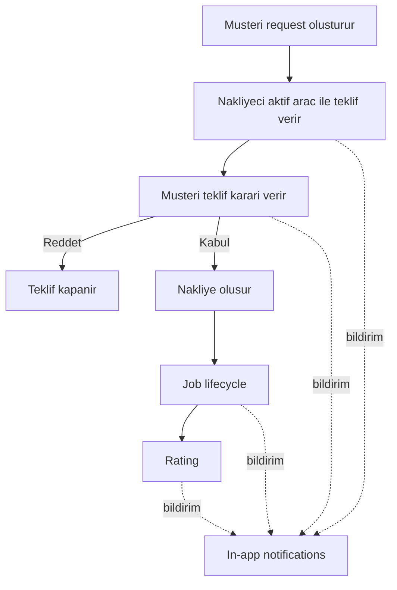
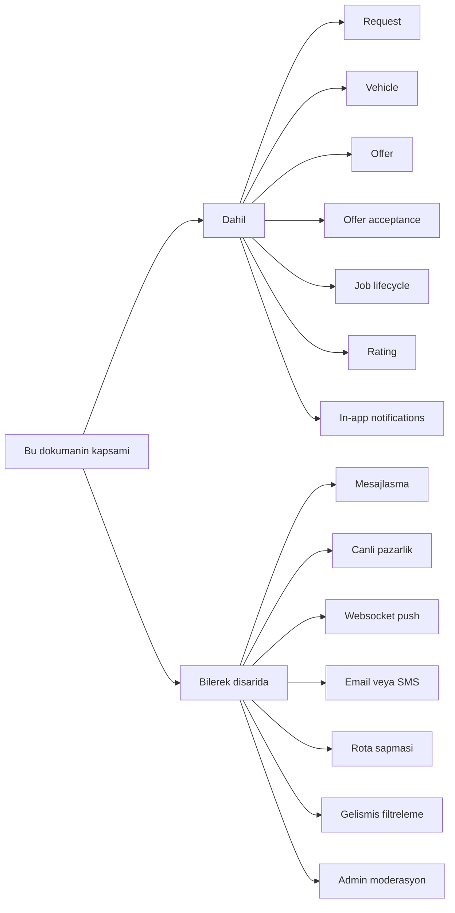

# Mermaid Flow Charts

## Amaç

Bu dokuman, projede bugune kadar gercekten uygulanmis ana akislari sunumda kullanilabilir Mermaid diagramlarla ozetler. Odak; MUSTERI ve NAKLIYECI akislarini, tekliften nakliyeye gecisi, nakliye lifecycle'ini ve rating mantigini temiz bicimde gostermektir.

## Musteri Akisi

Bu chart, musterinin sistemde request olusturmasindan tamamlanan nakliye icin rating vermesine kadar olan mevcut akisi gosterir. Burada sadece urunde gercekten acik olan adimlar vardir; mesajlasma veya canli pazarlik gibi sonraki fazlar dahil edilmemistir.

## Nakliyeci Akisi

Bu chart, nakliyecinin kayit sirasindaki ilk arac mantigindan teklif verme ve isi tamamlama sonrasi musteriye rating verme adimina kadar olan gercek urun akisini gosterir. `teklif_ver` bagimsiz bir ana akis olarak degil, acik istek detayindaki teklif adimi olarak temsil edilir.

## Tekliften Nakliyeye Gecis

Bu diagram, bir request uzerindeki teklifin musteri karariyla nasil resmi `Nakliye` kaydina donustugunu gosterir. Kabul edilmeyen teklif kendi basina kapanirken, kabul edilen teklif request durumunu ve diger acik teklifleri de etkiler.

## Nakliye Yasam Dongusu

Bu chart, job lifecycle icindeki resmi durum gecislerini gosterir. Musteri bu akista read-only gorunurluge sahiptir; aksiyon sahibi olan taraf nakliyecidir.

## Rating Akisi

Rating, yalnizca tamamlanmis nakliye ustunden acilir ve iki tarafli calisir. Ayrica ayni nakliyede ayni yon icin ikinci rating engellenir; profil ozeti de bu is bazli kayitlardan turetilir.

## Genel Sistem Ozeti

Bu overview, sistemin bugunku cekirdek domain halkalarini kisa ve sade bicimde gosterir. Notification katmani burada ana akis degil, destekleyici sinyal katmani olarak yanda tutulur.

## Notlar

Bu chart'lar mevcut kod ve en guncel akisa dayanir; eski docs ile celisen noktalarda bugunku uygulama esas alinmistir. Bilincli olarak sonraki faz ozellikleri ana diyagramlara sokulmamistir.

