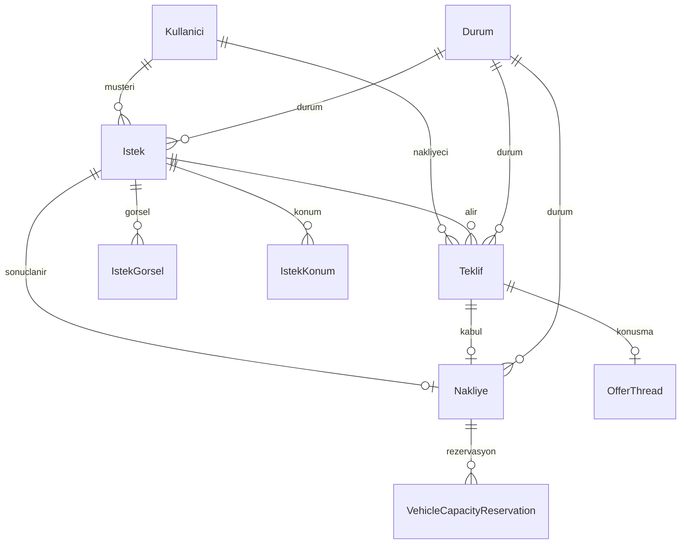

# Phase 6.1 - Veritabanı Normalizasyon ve 3NF Analiz Raporu

## 1. Amaç

Bu rapor, Nakliye App projesinin PostgreSQL veritabanı şemasını **1NF**, **2NF** ve **3NF** ilkelerine göre denetler; kötü redundancy ile bilinçli snapshot denormalizasyonunu ayırır; Phase 7 SOLID backend refaktörü öncesinde güvenli bir normalizasyon yol haritası sunar.

**Kapsam dışı bırakılanlar (bilinçli):**

- Harici kimlik katmanı (`publicId` UUID + numeric `id` join)
- İş mantığı ve API davranışının değiştirilmesi (yalnızca şema ve veri bütünlüğü)
- Hacim tahmini için ayrı kalıcı tablo (veri `Istek.agirlikKg` / `Istek.hacimM3` üzerinde; AI sonucu persist edilmiyor)

**Önceki referans:** [docs/38-schema-prisma-3nf-degerlendirme.md](../38-schema-prisma-3nf-degerlendirme.md) — OfferThread, CarrierRoute, capacity reservation, Phase 6 tarih planlama ve delivery confirmation o dokümanda yoktu; bu rapor onları genişletir.

**Kaynak şema:** `apps/api/prisma/schema.prisma` (18 model, 24+ migration).

---

## 2. Mevcut Veritabanı Yapısının Özeti

### 2.1 Domain grupları

| Grup | Tablolar |
|------|----------|
| Kimlik ve yetki | `Kullanici`, `Rol`, `KullaniciRol` |
| Lookup | `Durum`, `AracKutuphanesi`, `PuanTanimlari` |
| Taşıma talebi | `Istek`, `IstekGorsel`, `IstekKonum` (Phase 6.1 ile eklendi) |
| Teklif ve mesajlaşma | `Teklif`, `OfferThread`, `OfferThreadMessage`, `OfferThreadMessageAttachment` |
| Operasyon | `Nakliye`, `VehicleCapacityReservation` |
| Nakliyeci envanteri | `Arac`, `CarrierRoute` |
| Geri bildirim ve bildirim | `Puanlama`, `Bildirim` |

### 2.2 Çekirdek ilişki özeti

### 2.3 Phase 6 ve delivery confirmation ekleri

- **Phase 6:** `Teklif` ve `Nakliye` üzerinde `planlananAlimTarihi`, `tahminiTeslimTarihi` (nullable `TIMESTAMP`, CHECK: teslim ≥ alım veya null).
- **Delivery confirmation:** `Nakliye.teslimBildirimTarihi`, `NAKLIYE/TESLIM_BEKLIYOR` durumu; kabul edilmiş thread’lerin `closedAt` düzeltmesi (migration `20260523115900`).

---

## 3. 1NF Analizi

### 3.1 Sağlanan yönler

- Kolonlar atomic: koordinatlar ayrı `enlem`/`boylam`, medya metadata ayrı child tablolarda (`IstekGorsel`, `OfferThreadMessageAttachment`).
- CSV / çoklu değer tek hücrede yok.
- Tekil surrogate primary key (`id`) tüm ana tablolarda.

### 3.2 Dikkat noktaları

| Konu | Değerlendirme |
|------|----------------|
| `baslangic*` / `varis*` kolon aileleri (`Istek`, `CarrierRoute`) | Tekrarlayan **grup kökü**; 1NF ihlali değil ama modelleme borcu |
| `tasimaTarihi`, `CarrierRoute.planlananTarih` (`VARCHAR(10)`) | Atomic string; domain olarak tarih değil |
| Phase 6 plan tarihleri (`DateTime`) | Atomic timestamp; API date-only string ile eşleşir |

**Sonuç:** 1NF büyük ölçüde sağlanıyor; iyileştirme modelleme ve tip tutarlılığı ile ilgili.

---

## 4. 2NF Analizi

- Tüm tablolar tek sütunluk surrogate PK kullanıyor → partial dependency riski yok.
- `KullaniciRol`: `@@unique([kullaniciId, rolId])` — doğru M:N köprü.
- `Puanlama`: `@@unique([nakliyeId, puanlayanId, puanlananId])` — doğru.
- `OfferThread.offerId @unique` — teklif başına tek thread.

**Sonuç:** 2NF pratikte tam.

---

## 5. 3NF Analizi

### 5.1 Transitive dependency ve redundancy

| Alan | 3NF baskısı | Sınıf |
|------|-------------|--------|
| `Istek.baslangicSehri` vs `normalizeBaslangicSehir` | Yüksek — aynı gerçeğin iki kopyası | Kötü redundancy |
| `Durum` polymorphic lookup | Orta — `durumAdi` anlamı `durumTuru`ya bağlı; unique eksik | Bütünlük riski |
| `OfferThread.requestId`, `customerId`, `carrierId` | `offerId` üzerinden türetilebilir | Bilinçli denormalizasyon |
| `VehicleCapacityReservation.requestId`, `offerId` | `shipmentId` yeterli | Bilinçli audit |
| `Teklif.fiyat` → `Nakliye.anlasilanFiyat` | Kabul snapshot | Bilinçli |
| Phase 6 plan tarihleri Teklif → Nakliye | Operasyonel kopya | Bilinçli |
| `OfferThreadMessage.teklifFiyati` | Mesaj anı fiyatı | Bilinçli |

### 5.2 Sonuç

Şema iş görür ve büyük resimde bozuk değildir; tam 3NF değildir. En yoğun baskı **`Istek`** (konum + duplicate şehir) ve **`Durum`** (generic lookup + unique eksikliği) üzerindedir.

---

## 6. Tespit Edilen Normalizasyon Problemleri

### 6.1 Düzeltilmesi gereken (kötü redundancy)

1. Duplicate şehir alanları (`baslangicSehri` / `normalizeBaslangicSehir` ve varış simetriği).
2. `Durum(durumTuru, durumAdi)` için DB unique yok → duplicate seed satırları.
3. `AracKutuphanesi(marka, model)` unique yok → duplicate katalog.
4. `PuanTanimlari.puanlamaTuru` unique yok.
5. Tarih tipi tutarsızlığı: string `tasimaTarihi` vs `DateTime` plan tarihleri.
6. Prisma schema ↔ migration drift: `Arac.plaka` partial unique, `IstekGorsel` primary partial unique migration’da; schema’da tam yansımıyor.

### 6.2 Korunması gereken (kasıtlı snapshot)

- Teklif / nakliye fiyat ve plan tarihleri
- Rota `rotaMesafeMetre`, `rotaSureSaniye`
- Bildirim `hedefUrl`, `olayAnahtari`
- Thread türetilebilir FK’ler ve capacity reservation çoklu FK’ler

---

## 7. Tablo Bazlı Değerlendirme

### 7.1 `Kullanici` / `Rol` / `KullaniciRol`

**Durum:** İyi. Minimal değişiklik. Soft-delete + `mail`/`kullaniciAdi` unique yeniden kullanımı operasyonel konu (normalizasyon dışı).

### 7.2 `Durum`

**Problem:** Tek tabloda `ISTEK`, `TEKLIF`, `NAKLIYE`; kod sabit string çiftleri kullanıyor; `findFirst` ile aranıyor.  
**Öneri:** `@@unique([durumTuru, durumAdi])` (Faz 1); uzun vadede domain enum (Faz 4 / Phase 7).

### 7.3 `Istek` / `IstekGorsel`

**Problem:** ~20 konum kolonu; duplicate şehir; `tasimaTarihi` string.  
**Öneri:** `IstekKonum` child (Faz 3); `tasimaTarihiGun` `@db.Date` (Faz 2); şehir canonicalizasyon (Faz 2).

### 7.4 `Teklif`

**Durum:** İyi. Phase 6 plan tarihleri teklif snapshot’ı. `@@unique([istekId, nakliyeciId])` iş kuralı olarak düşünülebilir (3NF dışı).

### 7.5 `OfferThread` / mesajlar / ekler

**Durum:** İyi. `teklifFiyati` counter-offer geçmişi. Ekler 1NF uyumlu ayrı tablo.

### 7.6 `Nakliye`

**Durum:** İyi. `istekId @unique`, lifecycle timestamp’leri, dual delivery alanları yerinde.

### 7.7 `Arac` / `AracKutuphanesi`

**Problem:** Katalog unique yok. `kasaTipi` serbest metin.  
**Öneri:** `@@unique([marka, model])` (Faz 1).

### 7.8 `CarrierRoute`

**Problem:** `Istek` ile aynı konum kolon deseni; `planlananTarih` string.  
**Öneri:** `planlananTarihGun` (Faz 2); `CarrierRouteKonum` opsiyonel (Faz 5).

### 7.9 `VehicleCapacityReservation`

**Durum:** Kabul edilebilir. Ek FK’ler audit için kasıtlı.

### 7.10 `PuanTanimlari` / `Puanlama`

**Problem:** Fiilen tek scheme (`SAYISAL_1_5`); `puanlamaTuru` unique değil.  
**Öneri:** `@unique` (Faz 1).

### 7.11 `Bildirim`

**Problem:** `tip` serbest metin; publisher sabit kod listesi.  
**Öneri:** `BildirimTipi` enum (Faz 4).

### 7.12 Medya

`IstekGorsel` ve `OfferThreadMessageAttachment` yapısal benzerlik — ortak `MediaAsset` opsiyonel (Faz 5); 3NF zorunluluğu değil.

---

## 8. Önerilen Şema İyileştirmeleri

| Faz | İçerik | Risk |
|-----|--------|------|
| **F0** | Ölçüm ve dokümantasyon | Yok |
| **F1** | `Durum`, `AracKutuphanesi`, `PuanTanimlari` unique + duplicate merge | Orta |
| **F2** | Şehir canonicalizasyon; `tasimaTarihiGun`, `planlananTarihGun` + backfill | Düşük |
| **F3** | `IstekKonum` tablosu, dual-write, backfill; kolon drop ayrı PR | Yüksek |
| **F4** | `BildirimTipi` enum | Orta |
| **F5** | Opsiyonel: marka/model ayrımı, `MediaAsset`, `CarrierRouteKonum` | Değişken |

---

## 9. Riskli Alanlar

1. **Migration history drift:** DB’de repoda olmayan eski migration adları (`20260523120000_delivery_confirmation_and_thread_images` gibi). `migrate deploy` ile pending uygulanmalı; `reset` kullanılmamalı.
2. **Durum duplicate merge:** Yanlış FK birleştirme istek/teklif/nakliye durumlarını bozar — merge öncesi yedek ve doğrulama SQL zorunlu.
3. **Soft delete + unique:** `Arac.plaka` partial unique; `Kullanici.mail` tam unique — silinen kayıt yeniden kayıt politikası net değil.
4. **Dual-write dönemi:** `Istek` flat kolonlar ile `IstekKonum` tutarsızlığı — transaction içi yazım şart.
5. **Bildirim enum:** Bilinmeyen `tip` değeri migration’ı kırar — önce distinct değer audit.

---

## 10. Migration Stratejisi

1. Her faz ayrı migration klasörü; `prisma migrate deploy` (dev’de `migrate dev` yalnızca yeni migration üretirken).
2. Duplicate temizlik SQL → constraint → backfill → uygulama kodu sırası.
3. `db push` birincil çözüm değil; `migrate resolve` yalnızca kanıtlı drift’te.
4. Kolon drop (`Istek` konum flat) Faz 3’ten **ayrı PR** — bu uygulama paketinde drop yapılmaz.

---

## 11. Geriye Uyumluluk Planı

- API DTO’lar ilk fazlarda aynı alan adlarını döner (`baslangicSehri`, `tasimaTarihi` string).
- `publicId` ve numeric `id` değişmez.
- JWT / auth etkilenmez.
- Phase 6 teklif tarih zorunluluğu ve nakliye kopyası korunur.
- Okuma: `IstekKonum` varsa öncelik; yoksa flat kolon fallback.

---

## 12. Test ve Doğrulama Planı

- `npm run build:api`, `npm run build:web`
- `npm run test -w apps/api` — özellikle `offers.create-date-plan`, `offers.accept`, `offer-threads.*`, `jobs.complete`
- Migration sonrası: unique constraint varlığı, `IstekKonum` satır sayısı = 2 × aktif istek (yaklaşık)
- Manuel smoke: istek oluştur, teklif (tarihli), kabul, nakliye plan tarihleri, konuşma, bildirim listesi

---

## 13. Sonuç

Mevcut şema üretim için yeterli; en büyük teknik borç **`Istek` konum modellemesi** ve **lookup unique eksiklikleridir**. Phase 7 öncesi önerilen minimum paket: **Faz 1 + Faz 2 + Faz 3 (dual-write, drop yok) + Faz 4 (bildirim enum)**.

Kötü redundancy azaltılırken teklif fiyatı, plan tarihleri, rota metrikleri ve bildirim audit kayıtları bilinçli olarak korunmuştur — bu, operasyonel doğruluk ve geçmiş izlenebilirlik için doğru trade-off’tur.

---

*Rapor tarihi: Phase 6.1 uygulama paketi ile birlikte oluşturulmuştur. Uygulama migration adları: `20260525120000_phase61_integrity_constraints`, `20260525130000_phase61_date_columns`, `20260525140000_phase61_istek_konum`, `20260525150000_phase61_bildirim_tip_enum`.*
